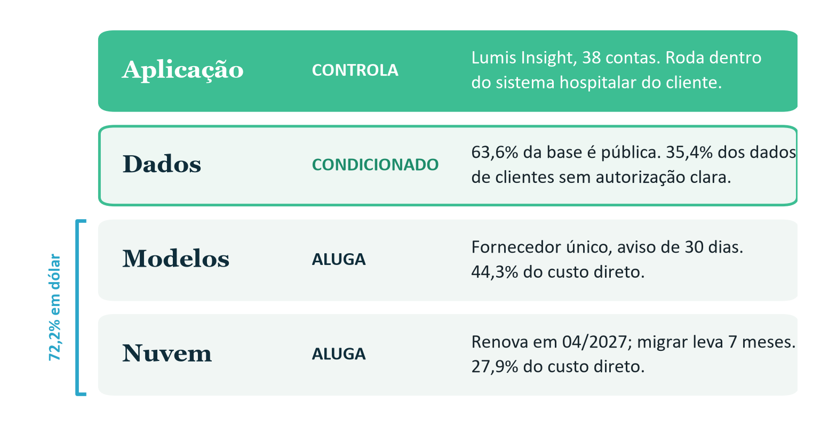

# F2-E1 · Mapa do Território

> Texto da Entrega 1 como foi no documento único (`F2-D_Documento_Integrado_v3.docx`), com os quadros de apoio desta entrega que estão no Apêndice B. É uma cópia para leitura: se houver diferença, vale o .docx. Os números de figura, tabela, seção e nota são os do documento único. Extraído em 09/10/2026.

## Entrega 1 · O mapa do território

> **O que faz o Lumis Insight funcionar é alugado, e o único ativo que poderia ser da Lumis, a base de dados, ainda não é dela. Por isso, a tese de crescimento precisa partir do que ainda vai ser construído.**

### 1.1 Onde a Lumis está

A Lumis só controla a camada de cima. Nas outras três, aluga ou depende da autorização de terceiros.

*Figura 3. O que a Lumis controla em cada camada. Fonte: Cap. 2, Quadros 3, 4, 5 e 7; conta e leitura da equipe.*

Para Shapiro e Varian[^2], o valor fica com quem controla o gargalo. Aqui os gargalos são a distribuição dentro do hospital e o direito de usar o dado de desfecho, e nenhum dos dois está com a Lumis. Por isso ela negocia em desvantagem com os fornecedores de cima e com os clientes grandes, que podem fazer a própria IA. Na nossa leitura, tem mais força com os clientes médios.

### 1.2 Quem pode tomar esse espaço

O mercado endereçável no Brasil é estimado em R$ 2,1 bilhões em 2026 e R$ 3,4 bilhões em 2029, e a Lumis tem cerca de 2% dele. A ameaça vem de quatro direções, da mais forte para a mais fraca (Tabela 15, Apêndice B):

1. **Dentro do hospital: a Aster Health, concorrente direta.** Vende a IA como módulo, por R$ 340 mil a mais, sobre o contrato que o hospital já tem, padrão que já existe no Brasil com os prontuários da MV e da Philips (Tasy)[^3]. Por depender do sistema hospitalar, não chega a seguradoras e bancos (14 das 38 contas da Lumis).
1. **O próprio cliente.** Os grandes clientes são os que mais conseguem fazer a própria IA; o Einstein já usa perto de 120 algoritmos próprios[^4].
1. **De cima: os fornecedores.** O fornecedor de modelo anunciou um módulo próprio para saúde e passa a concorrer na aplicação.
1. **Por fora: os indiretos.** A Núcleo Saúde Analytics tem 74 contas de BI hospitalar, quase o dobro da Lumis, e só lhe falta a camada preditiva; consultorias e integradores vendem projetos sob medida aos clientes grandes.

Distribuição não garante qualidade: o modelo de sepse da Epic, embutido no prontuário, deixou de identificar dois terços dos casos[^5]. Mas a Lumis ainda não pode competir por qualidade, porque os 94% de acurácia caem para 87,6% em campo.

### 1.3 O que pode mudar sem a Lumis decidir

Das cinco dependências (Tabela 16, Apêndice B), duas pedem atenção agora, e as duas têm prazo:

- **Dados de clientes, a mais grave.** É a única sem substituto, e o risco já existe: o modelo atual foi treinado com os 35,4% dos dados de clientes que têm autorização fraca ou nenhuma, e os contratos da Prisma e do Vila Ipê vencem em 12/2026 e 03/2027.
- **Fornecedor de modelo, a mais rápida.** Muda preço e termos com 30 dias de aviso. Se o preço dobrar, a margem bruta cai de 58% para 39,5%, e o caixa passa a durar 8,7 meses, em vez de 11,6. Há precedente: a Anthropic lançou em 2024 a nova versão do Haiku a quatro vezes o preço da anterior[^6].

As outras três pedem negociação: proteção cambial para os 72,2% do custo em dólar, plano de saída da nuvem antes da renovação de 04/2027 e teto de reajuste nas bases clínicas.

### 1.4 O que é difícil de copiar

Nada do que a Lumis tem hoje é difícil de copiar, e as duas partes que mais valem, a base histórica e a validação clínica, estão travadas.

| Hoje | Elemento | Por quê |
|---|---|---|
| Copiável | Modelo e tecnologia de IA | É de terceiro, à venda por consumo, com preço em queda. |
| Parcialmente difícil | Produto especializado | A Aster embute priorização no hospital, e os grandes clientes internalizam. |
| Parcialmente difícil | Integração e relacionamento | Churn de 11% ao ano; a retenção não foi testada contra a Aster. |
| Moderadamente difícil | Conhecimento e equipe | 48 técnicos e 4 anos de domínio, que saem da empresa com as pessoas. |
| Valioso, mas travado | Base histórica | Dados de clientes com autorização fraca e viés. Destrava com contratos regularizados e viés corrigido. |
| Valioso, mas travado | Validação clínica | Os 94% caem para 87,6% em campo. Destrava com validação em campo por grupo. |
| Difícil de copiar | Nada hoje | A construir: dado de desfecho com direito de uso limpo e prova auditável de desempenho por grupo. |

*Tabela 3. Cada elemento, do mais fácil ao mais difícil de copiar. Fonte: Cap. 2, Anexo A; classificação da equipe.*

Só os dados de clientes, 26,8% da base, são exclusivos da Lumis (Figura 4), e estão concentrados: só 2 dos 24 clientes de saúde fornecem dados, e cerca de três quartos do dado clínico de clientes vêm da Rede Sanare.

O que pode virar barreira é o histórico de 2019 a 2026, se ele registrar a priorização clínica brasileira junto com o desfecho, algo que nenhum fornecedor de modelo tem [hipótese]. Para chegar lá, propomos regularizar os contratos de dados antes dos vencimentos e estender o direito de uso aos demais clientes; trocar os 94% por validação em campo, por grupo e publicada (seção 5.4); e focar em hospitais e seguradoras médios, que não fazem a própria IA, com o crédito para bancos só em teste em paralelo (seção 4.4).

## Quadros de apoio (Apêndice B do documento único)

| Ameaça | Por que preocupa | O que joga a favor da Lumis |
|---|---|---|
| 1. Dentro do hospital: Aster Health (direto) | Vende a IA como módulo, por R$ 340 mil a mais, sobre o contrato que o hospital já tem, num sistema usado em 210 hospitais. O padrão já existe no Brasil com os prontuários da MV e da Philips (Tasy)[^3]. | A Aster não chega a seguradoras e bancos, que são 14 das 38 contas. |
| 2. O próprio cliente: grandes clientes (potencial) | São os que mais conseguem fazer a própria IA. O Einstein, por exemplo, já usa perto de 120 algoritmos próprios[^4]. | Clientes médios, sem time próprio de IA, dependem mais de fornecedores externos [hipótese]. |
| 3. De cima: os próprios fornecedores (potencial) | O fornecedor de modelo anunciou um módulo próprio para saúde e passa a concorrer na aplicação. Nuvem e bases clínicas podem seguir o mesmo caminho [hipótese]. | Nenhum deles tem hoje o fluxo clínico dentro do hospital [hipótese]. |
| 4. Por fora: Núcleo Saúde Analytics (indireto) | Já tem 74 contas de BI hospitalar, quase o dobro da Lumis, e só falta a camada preditiva. | A Lumis já entrega a camada preditiva que falta à Núcleo. |
| 4. Por fora: consultorias e integradores (indireto) | Vendem projetos sob medida aos clientes grandes, sobre a mesma infraestrutura e os mesmos modelos. | Produto pronto, com ticket médio anual de R$ 1,084 mi, contra R$ 1,5 a 4,0 mi por projeto. |

*Tabela 15. As ameaças, da mais forte para a mais fraca. Fonte: Cap. 2, Quadros 3 e 6; leitura da equipe.*

| Dependência | Prazo | O que pode acontecer | Resposta recomendada |
|---|---|---|---|
| Dados de clientes | Já hoje; contratos vencem em 12/2026 (Prisma) e 03/2027 (Vila Ipê) | Questionamento do uso atual obriga a retirar 35,4% dos dados de clientes e retreinar; renegociação restringe o uso; multa da LGPD de até 2% do faturamento, limitada a R$ 50 mi por infração[^1]; clientes grandes levam os dados para a Aster. | Revisão jurídica dos seis instrumentos; aditivos de direito de uso antes dos vencimentos; linhagem de dados para isolar os registros frágeis. |
| Modelo fundacional (44,3% do custo) | 30 dias de aviso, a qualquer momento | Margem de 54,3% com preço +20% e de 39,5% com +100%; descontinuação obriga a revalidar o sistema; fornecedor vira concorrente. | Homologar um segundo fornecedor; travar preço e versão; avaliar modelo próprio no núcleo preditivo. |
| Câmbio (72,2% do custo em dólar) | Contínuo | Cada R$ 0,10 a mais no dólar custa R$ 19.240 por mês; a R$ 6,50, a margem vai a 51,9%. | Proteção cambial e cláusula de reajuste nos contratos com clientes. Se já há essa proteção [não consta]. |
| Nuvem (27,9% do custo) | Renovação em 04/2027; migrar leva 7 meses | Renovação sem alternativa; cada 10% de reajuste custa R$ 40.176 por mês. | Começar já o plano de portabilidade; negociar cláusulas de saída. |
| Bases clínicas (7,8% do custo) | Renovação anual automática | Reajuste sem teto; a renovação automática dificulta a saída. | Negociar teto de reajuste na renovação. |

*Tabela 16. As cinco dependências e o que recomendamos (ainda não praticado). Fonte: Cap. 2, Quadros 3, 4, 5 e 7; cálculos da equipe.*

## Referências citadas

[^1]: BRASIL. Lei nº 13.709, de 14 de agosto de 2018. Lei Geral de Proteção de Dados Pessoais (LGPD). Texto compilado. Disponível em: https://www.planalto.gov.br/ccivil_03/_ato2015-2018/2018/lei/l13709.htm. Acesso em: 7 out. 2026.
[^2]: SHAPIRO, C.; VARIAN, H. R. Information Rules: A Strategic Guide to the Network Economy. Boston: Harvard Business School Press, 1999.
[^3]: MV. MV se torna a 5ª maior fornecedora global de prontuário eletrônico hospitalar (dados KLAS 2025). 4 ago. 2025. Disponível em: https://mv.com.br/imprensa/mv-se-torna-a-5a-maior-fornecedora-global-de-prontuario-eletronico-hospitalar. Acesso em: 5 out. 2026.
[^4]: CONVERGÊNCIA DIGITAL. Hospital Israelita Albert Einstein: algoritmos, IA e inovação salvam vidas. 8 jan. 2025. Disponível em: https://convergenciadigital.com.br/mercado/hospital-israelita-albert-einstein-algoritmos-ia-e-inovacao-salvam-vidas/. Acesso em: 5 out. 2026.
[^5]: WONG, A. et al. External Validation of a Widely Implemented Proprietary Sepsis Prediction Model in Hospitalized Patients. JAMA Internal Medicine, v. 181, n. 8, p. 1065-1070, 2021.
[^6]: TECHCRUNCH. Anthropic hikes the price of its Haiku model. 4 nov. 2024. Disponível em: https://techcrunch.com/2024/11/04/anthropic-hikes-the-price-of-its-haiku-model. Acesso em: 5 out. 2026.
