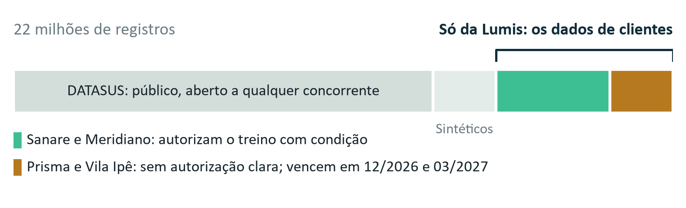
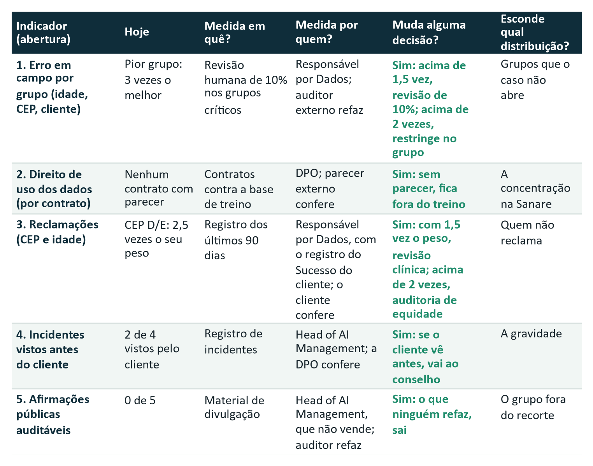
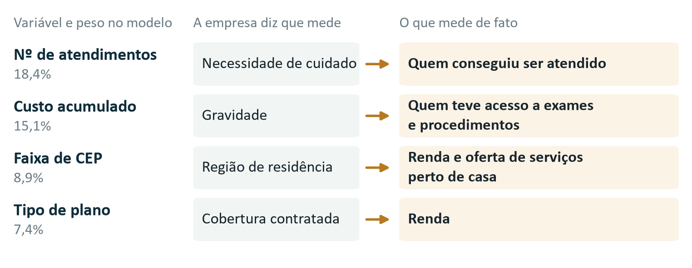
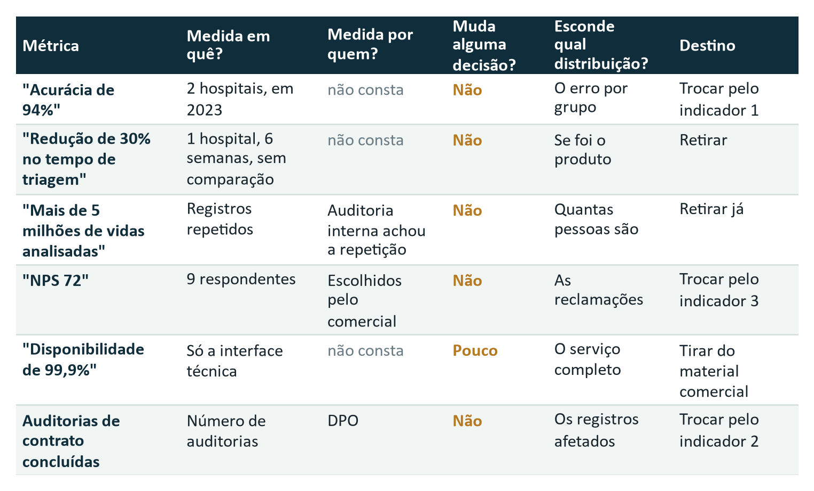

# F2-E2 · Auditoria do Ativo: Dados e Métricas

> Texto da Entrega 2 como foi no documento único (`F2-D_Documento_Integrado_v3.docx`), com os quadros de apoio desta entrega que estão no Apêndice B. É uma cópia para leitura: se houver diferença, vale o .docx. Os números de figura, tabela, seção e nota são os do documento único. Extraído em 09/10/2026.

## Entrega 2 · Auditoria do ativo: dados e métricas

> **Hoje o ativo da Lumis não passa numa auditoria independente. A parte da base que só a Lumis tem está sob contratos frágeis, e o modelo erra mais justamente com quem mais precisa de prioridade.**

### 2.1 De onde vêm os dados e se a Lumis pode usá-los

*Figura 4. A base de treinamento do Lumis Insight. Fonte: Cap. 2, Quadro 7.*

- **Só pouco mais de um quarto da base é exclusivo da Lumis.** O DATASUS, a maior parte, está aberto a qualquer concorrente. Dos dados de clientes, 35,4% (2,09 milhões de registros) vêm de contratos que não autorizam o treino com clareza, e esses são os primeiros a vencer.
- **O risco já existe.** Nenhum dos seis instrumentos que dão base aos dados passou por revisão jurídica desde a assinatura, e o modelo atual já foi treinado com esses dados. A LGPD pede finalidade específica e informada para dado de saúde[^1], e quem trata dados em nome do cliente só pode usá-los para a finalidade definida por ele[^7]. Uma cláusula de "melhoria contínua do serviço" dificilmente cobre treinar um produto vendido a outros clientes.
- **Parte dos dados é anterior à empresa.** Há registros desde 2019, e a Lumis foi fundada em 2022.

**Recomendação:** parecer da DPO sobre os seis instrumentos antes do próximo treino, e renegociação de Prisma e Vila Ipê antes do vencimento, incluindo o histórico.

### 2.2 O que o modelo mede de fato

As duas variáveis que mais pesam no modelo deveriam medir necessidade e gravidade. Na prática, medem acesso: quem conseguiu ser atendido e quanto isso custou. Com outras duas, são quatro variáveis e 49,8% do peso medindo acesso (Figura 6, Apêndice B). Quem teve menos acesso parece menos grave. É o problema da variável substituta (proxy), e o caso registra que "foi exatamente isso que aconteceu no incidente da Fase 1" (Cap. 2, seção 2.2).

O mesmo erro já apareceu fora daqui: nos Estados Unidos, um algoritmo que previa o custo do paciente no lugar da doença dava a pacientes negros, com menos acesso, o mesmo escore de pacientes brancos mais saudáveis[^8].

### 2.3 O que acontece em campo

Os 94% de acurácia vêm de uma amostra de 2023 com dois hospitais da mesma região. Em campo, a parcela de pacientes que precisavam de prioridade e não receberam mais que dobrou, e o erro se concentra em quem já é mais vulnerável (Figura 2, seção 5.2). Quem mediu o pior número foi o Hospital Vila Ipê, e não a Lumis.

### 2.4 Os números que mostramos ao mercado

O Vetor Capital avisou: número que não sobrevive a uma auditoria independente vira passivo. Passamos as cinco afirmações do painel comercial pelas quatro perguntas sobre métricas (Figura 7, Apêndice B), e nenhuma fica como está:

- os 94% de acurácia valem para a validação de 2023; em campo, 87,6%;
- os 30% de redução vêm de um piloto de seis semanas sem grupo de controle;
- os 5,2 milhões de "vidas analisadas" contam registros, com o mesmo paciente repetido; o erro foi achado em janeiro e continua no material comercial;
- o NPS 72 vale para 9 respondentes escolhidos pelo comercial;
- os 99,92% de disponibilidade cobrem só a interface de programação.

Manter esses números contradiz o compromisso de Transparência, da Declaração de Intenção da Fase 1.

### 2.5 O que passamos a medir e o que decidimos agora

No lugar dessas métricas, propomos cinco indicadores (Figura 5). Cada um muda uma decisão concreta, se abre por grupo quando cabe e tem um conferente que não produziu o número. O Responsável por Dados apura os indicadores 1 e 3, a DPO o 2 e o Head of AI Management o 4 e o 5.

*Figura 5. Os cinco indicadores, com limites propostos pela equipe. Fonte: Cap. 2, Quadros 7, 10, 11, 14 e 17.*

**A decisão de agora.** Dois grupos já passam do limite do indicador 1 (2 vezes o erro do melhor grupo): idosos de CEP C e de CEP D/E. Diante de padrão de viés, o compromisso de Não Amplificação de Danos prevê investigar a causa, corrigir e, quando necessário, suspender o uso até a correção. Por isso recomendamos restringir já a recomendação automática nesses grupos: o Head of AI Management ordena e o CTO executa. Cerca de um quarto das priorizações, por volta de 154 mil por mês, volta à triagem do hospital [hipótese: distribuição das decisões igual à da base], e o modelo segue rodando em paralelo, sem decidir, para medir a correção.

## Quadros de apoio (Apêndice B do documento único)

*Figura 6. Quatro variáveis (49,8% do peso do modelo) medem acesso. Das outras seis, a idade (12,7%) mede o que diz medir; comorbidades e exames só captam o que foi diagnosticado ou pedido, e tempo até o exame, faltas e especialidade de origem também dependem da fila e do acesso à rede [hipótese]. Fonte: Cap. 2, Quadro 8; conta e leitura da equipe.*

*Figura 7. As cinco afirmações do painel comercial e um indicador que descartamos (auditorias de contrato), com as quatro perguntas sobre métricas. Todos saem ou são trocados. Fonte: Cap. 2, Quadros 9, 11 e 14; leitura da equipe.*

## Referências citadas

[^1]: BRASIL. Lei nº 13.709, de 14 de agosto de 2018. Lei Geral de Proteção de Dados Pessoais (LGPD). Texto compilado. Disponível em: https://www.planalto.gov.br/ccivil_03/_ato2015-2018/2018/lei/l13709.htm. Acesso em: 7 out. 2026.
[^7]: ANPD. Guia Orientativo para Definições dos Agentes de Tratamento de Dados Pessoais e do Encarregado. Versão 2.0, 2022.
[^8]: OBERMEYER, Z. et al. Dissecting racial bias in an algorithm used to manage the health of populations. Science, v. 366, n. 6464, p. 447-453, 2019.
