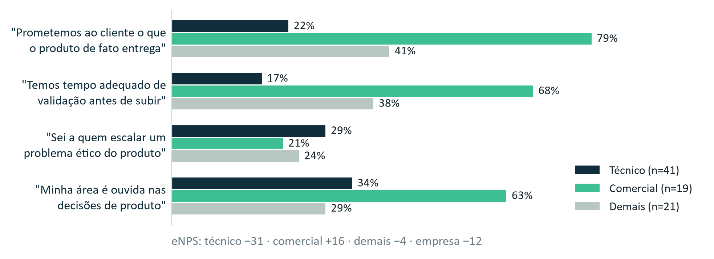

# F2-E4 · Diagnóstico de Cultura e Funil de Inovação

> Texto da Entrega 4 como foi no documento único (`F2-D_Documento_Integrado_v3.docx`), com os quadros de apoio desta entrega que estão no Apêndice B. É uma cópia para leitura: se houver diferença, vale o .docx. Os números de figura, tabela, seção e nota são os do documento único. Extraído em 09/10/2026.

## Entrega 4 · Cultura e funil de inovação

> **O técnico e o comercial discordam sobre quanto tempo validar, mas partem da mesma crença: a qualidade se prova antes de o produto ir a campo, pela média. Propomos um único critério para decidir o que se promete e o que se constrói: o desempenho medido em campo por grupo de pacientes. Com ele, recusamos três dos sete pedidos do backlog.**

Nos próximos seis meses, as equipes de produto e engenharia têm 30 meses-pessoa livres para iniciativas novas (um mês-pessoa é o trabalho de uma pessoa durante um mês; 30 equivalem a cinco pessoas no semestre inteiro). O backlog pede 97, mais de três vezes isso, e não tem critério de risco, de prova ou de encerramento.

### 4.1 A cultura em três camadas

Lemos a cultura pelas três camadas de Schein[^9] (Tabela 19 e Figura 8, Apêndice B):

- **O que se vê:** o número de vitrine (94%) segue no material, contra 87,6% em campo; o erro de 01/2026 seguiu no material comercial; quem mediu o erro por grupo foi o hospital; o backlog registra quem pediu, e não o risco. A rotatividade em doze meses foi de 27% no time de dados, contra 19% na empresa.
- **O que se diz:** o técnico diz que o comercial promete o que o produto não entrega; o comercial diz que o técnico atrasa tudo em nome de um rigor que o cliente não pede.
- **O que se dá como óbvio** [hipótese]: "aqui, modelo validado é modelo bom: a qualidade se prova antes de o produto ir a campo, pela média, e depois disso o número vale".

Se a qualidade se resolve antes, só resta discutir quanto tempo gastar antes, e sem número de campo por grupo a discussão não tem árbitro. A crença também explica por que o comercial tem mais voz (63% do comercial dizem que a área é ouvida nas decisões de produto, contra 34% do técnico): depois do lançamento, a única informação nova que circula é a do cliente que compra, e quem a traz é o comercial. Inferimos o pressuposto dos quadros, sem entrevistas; a mesa de campo e a pesquisa de 01/2027 servem para testá-lo.

### 4.2 Duas intervenções

Comunicado interno quase nunca resolve pressuposto. As duas intervenções mudam o que se mede e quem decide.

- **A. Regra única de prova.** Nenhum número de desempenho sai da empresa sem o resultado de campo aberto por grupo, com amostra e data. Vale para material, proposta, aditivo e liberação de versão, e incidente só fecha com o material corrigido. Responsável: Head of AI Management; o Responsável Comercial aplica. Prazo: 30 dias para as cinco afirmações do painel. Sinal de que funcionou: as cinco afirmações públicas auditáveis ou retiradas (hoje, nenhuma é auditável).
- **B. Mesa de campo quinzenal.** Técnico, comercial, dados, produto, DPO e Head of AI Management leem juntos o erro por grupo e as reclamações por faixa de CEP e idade. A mesa propõe o prazo de validação, que o CTO decide, e responde com data aos pedidos do comercial. Responsável: Responsável por Produto. Prazo: primeira reunião em 15 dias; prazos de validação publicados em 60. Sinal de que funcionou: reclamações cruzadas com o desempenho toda quinzena (hoje, nunca).

As duas áreas ganham: o técnico, prazo de validação com regra; o comercial, prazo conhecido e um número que resiste a uma due diligence. A mesa é também a semente do comitê de risco e ética que a Lumis não tem. Para medir a percepção, repetimos as afirmações da pesquisa de clima numa pesquisa curta em 01/2027, aplicada por terceiro, e esperamos pelo menos 10 pontos a mais no técnico e em "sei a quem escalar" (hoje, cerca de 26%). O resultado é julgado na pesquisa de 07/2027.

### 4.3 Funil de inovação

Cada passagem é um portão com quatro saídas, como no Stage-Gate[^10]: seguir, encerrar, pausar com data ou voltar. Os critérios são eliminatórios, sem nota somada, para que receita não compense risco aos pacientes. Pipeline, explicabilidade e ISO/IEC 42001 seguem a priorização do Responsável por Produto, com parecer do Head of AI Management.

| Etapa | Entra quando | Avança quando | Encerra quando |
|---|---|---|---|
| Entrada | Ficha com problema, cliente nomeado, base legal dos dados e métrica de sucesso | Cliente no foco da Entrega 1 ou exceção registrada; nenhuma dependência nova de fornecedor único; nada contra os compromissos; responsável com cargo | Falha em qualquer critério |
| Descoberta (até 10% do esforço) | Aprovada na Entrada | Cliente com intenção de compra e dados autorizados por escrito; amostra para medir o erro em todo grupo; responsável do domínio nomeado | A fatia ou o prazo acabam e falta algum item |
| Teste em paralelo (até mais 30%) | Roda junto ao processo atual, sem decidir | Quatro leituras quinzenais com o pior grupo até 1,5 vez o erro do melhor (no crédito, aprovação em cada faixa de CEP de pelo menos 80% da melhor) | Seis leituras com algum grupo acima de 2 vezes |
| Produção limitada | Condições de frente nova (Tabela 7); autorização da CEO por cliente | Leitura sem piora em nenhum grupo; número publicado | Sem correção em seis leituras |
| Escala | Auditoria independente contratada | Indicadores contínuos | Suspensão pela seção 3.3 |

*Tabela 6. Critérios de cada etapa. Fatias e número de leituras: proposta da equipe; limites de erro das Entregas 2, 3 e 5.*

Em cada etapa, o comercial só diz o que ela já provou: "em estudo" na Entrada e na Descoberta, "em teste", sem número, no teste em paralelo, e o erro por grupo medido em campo na produção limitada e na escala.

- **Quem pediu não decide.** Os pedidos do sócio-fundador, do investidor e do comercial passam pelo mesmo portão. A CEO pode decidir contra um parecer contrário, mas só por escrito, e o caso vai ao conselho.
- **Recurso por etapa e encerramento definido antes.** Nenhuma iniciativa passa de 10 meses-pessoa sem nova decisão. Encerra a que gastar a fatia sem evidência nova, não obtiver o direito de uso dos dados até a data marcada ou tiver a estimativa de esforço aumentada em mais de 50%.

### 4.4 Como dividimos o tempo da equipe

Não partimos de uma proporção pronta. Dividimos os 30 meses-pessoa por ordem de prioridade: primeiro o que a Lumis já se comprometeu a fazer, depois o que constrói o ativo da seção 1.4 e, por último, o que traz mais receita por mês de trabalho. A divisão que resulta põe quase oito de cada dez meses em melhorar o produto atual, porque é ele que hoje não passa numa auditoria.

- **Melhoria do produto atual, 23,4 meses-pessoa (78%):** compromissos já assumidos (3,0), correção do viés (3,5), explicabilidade (9,0), primeira fatia do pipeline (7,2) e diagnóstico da ISO/IEC 42001 (0,7). Expandir antes de resolver a base de dados é "replicação de um problema em escala maior" (Cap. 2, seção 2.6).
- **Expansão adjacente, 5,6 (19%):** crédito para os bancos já clientes, até o fim do teste em paralelo. Tem a maior receita por esforço, R$ 0,6 milhão por mês-pessoa, 5 bancos já clientes e um terreno onde a Aster não chega.
- **Transformação, 1,0 (3%):** testar se a prova de desempenho por grupo, o ativo da seção 1.4, vira oferta. É a nossa resposta à plataforma que o Vetor propõe.

### 4.5 O que recusamos

- **Módulo veterinário, pedido pelo sócio-fundador: recusado.** Domínio cujos dados e erros a Lumis não conhece, sem responsável do domínio e fora do foco. Ocuparia 53% da capacidade por 11% da receita listada. Só volta com parceiro de dados autorizados, responsável do domínio e o erro por grupo dentro do limite no Brasil.
- **Agente de triagem, pedido pelo comercial: recusado neste ciclo.** Automatizaria de novo a etapa do erro de 31,8%. Volta ao portão com o pior grupo até 1,5 vez o melhor e a explicabilidade pronta.
- **México, pedido pelo investidor: fora desta janela.** Ocuparia 73% da capacidade, sem dado local para medir o erro por grupo. É reavaliado ao fim da janela de seis meses.

As recusas vêm de lados diferentes e abrem mão de R$ 11,3 milhões dos R$ 19,7 milhões de receita potencial em 12 meses do backlog (57,4%), um teto sem garantia de realização. Triplicar o time técnico antes de as intervenções rodarem levaria gente nova para o mesmo pressuposto [hipótese]; por isso propomos contratar em ondas. Há ainda um risco de pessoa-chave: o Responsável por Dados aparece em quase todos os portões, num time com rotatividade de 27%.

## Quadros de apoio (Apêndice B do documento único)

*Figura 8. Concordância por grupo; pesquisa de julho de 2026 com 81 de 96 colaboradores. Fonte: Cap. 2, Quadro 15.*

| Camada | O que encontramos |
|---|---|
| Artefatos | O número de vitrine (94%) segue no material, contra 87,6% em campo; o erro de 01/2026 seguiu no material comercial; quem mediu o erro por grupo foi o hospital; o backlog registra quem pediu, e não o risco; rotatividade de 27% no time de dados, contra 19% na empresa. |
| Valores declarados | O técnico diz que o comercial promete o que o produto não entrega. O comercial diz que o técnico atrasa tudo em nome de um rigor que o cliente não pede. 63% do comercial dizem que a área é ouvida nas decisões de produto, contra 34% do técnico. |
| Pressupostos | Cada área acredita vender uma coisa: confiabilidade ou velocidade (Cap. 2, seção 2.5). Por baixo das duas, a mesma crença: "aqui, modelo validado é modelo bom" [hipótese]. |

*Tabela 19. A cultura nas três camadas de Schein. Fonte: Cap. 2, seções 1.2 e 2.5 e Quadros 9, 10, 11, 14, 15, 16 e 17; leitura da equipe.*

| Horizonte | O que recebe | Meses-pessoa |
|---|---|---|
| Melhoria do produto atual | Compromissos já assumidos 3,0; correção do viés 3,5; explicabilidade 9,0; primeira fatia do pipeline 7,2; diagnóstico da ISO/IEC 42001 0,7 | 23,4 (78%) |
| Expansão adjacente | Crédito para bancos, até o fim do teste em paralelo | 5,6 (19%) |
| Transformação | Descoberta da prova de desempenho por grupo como oferta | 1,0 (3%) |
| Recusados | Módulo veterinário (53% da capacidade); agente de triagem; México (73% da capacidade). Juntos, R$ 11,3 mi dos R$ 19,7 mi de receita potencial em 12 meses (57,4%) | 0 |

*Tabela 20. Distribuição por horizonte e as três recusas. Proposta da equipe sobre o Cap. 2, Quadro 16.*

## Referências citadas

[^9]: SCHEIN, E. H.; SCHEIN, P. A. Organizational Culture and Leadership. 5. ed. Hoboken: Wiley, 2017. A bibliografia do curso registra a edição como de 2016.
[^10]: COOPER, R. G. Stage-gate systems: a new tool for managing new products. Business Horizons, v. 33, n. 3, p. 44-54, 1990.
