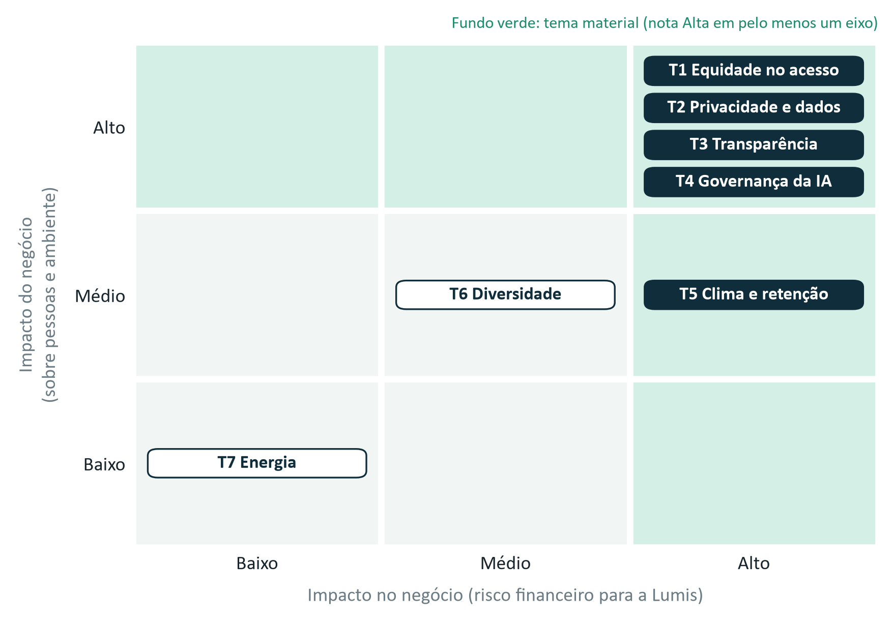
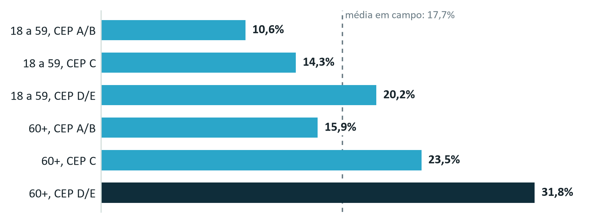

# F2-E5 · Due Diligence ESG da Expansão

> Texto da Entrega 5 como foi no documento único (`F2-D_Documento_Integrado_v3.docx`), com os quadros de apoio desta entrega que estão no Apêndice B. É uma cópia para leitura: se houver diferença, vale o .docx. Os números de figura, tabela, seção e nota são os do documento único. Extraído em 09/10/2026.

## Entrega 5 · Due diligence ESG da expansão

> **A expansão leva para novos mercados quatro riscos que a Lumis ainda não resolveu no Brasil: equidade, privacidade, transparência e governança. Ela só se sustenta com condições prévias e com uma métrica pública, o falso negativo por grupo publicado a cada trimestre, que mostre se o dano está caindo.**

Analisamos a expansão proposta pelo Vetor Capital (dois novos países e o Lumis Insight como plataforma) e dois casos do backlog: o México e o módulo de risco de crédito para bancos.

### 5.1 O que é material

Demos a cada tema duas notas: o dano que o negócio pode causar a pessoas e ao ambiente, e o risco financeiro que o tema traz para a Lumis. É material o tema com nota Alta em pelo menos um dos eixos.

*Figura 1. Matriz de materialidade dupla; a evidência de cada tema está na Tabela 10, no Apêndice B. Fonte: Cap. 2, Anexo A; notas da equipe.*

Equidade, privacidade, transparência e governança têm nota Alta nos dois eixos, já são problemas hoje e crescem com a expansão: mais clientes no mesmo modelo, populações sem histórico na base e dados de saúde cruzando fronteiras. Clima e retenção também é material, pelo risco à Lumis (eNPS de −31 no time técnico), e a Entrega 4 trata dele. Diversidade e energia ficam em monitoramento.

### 5.2 Quem pode ser prejudicado

O erro cresce com a idade e com a faixa de CEP. No grupo de 60 anos ou mais de CEP D/E, quase um em cada três pacientes que precisavam de prioridade não a recebe. A faixa D/E concentra 64% das reclamações, e a empresa nunca cruzou essas reclamações com o desempenho do modelo.

*Figura 2. Pacientes que precisavam de prioridade e não receberam, 1º semestre de 2026. Fonte: Cap. 2, Quadros 9 e 10.*

Na expansão, o grupo em risco muda com a frente (Tabela 11, Apêndice B). Na plataforma e nos novos países, perde quem tem pouco acesso à rede de saúde, porque as variáveis de acesso somam quase metade do peso do modelo (seção 2.2). No México, a Lumis não tem dado local de desfecho e não sabe onde vai errar. No crédito, CEP e cobertura reaproveitados do modelo de saúde podem negar crédito por endereço [hipótese].

**Como vamos medir.** Com dois indicadores da Entrega 2, lidos a cada quinze dias pelo Responsável por Dados:

- **Erro por grupo:** quantas vezes o grupo com mais erro erra em relação ao melhor. Hoje é 3,0. Propomos como limite o dobro e como meta 1,5 vez em 12 meses (seção 5.4).
- **Reclamações cruzadas com o erro:** se um grupo reclama mais do que o seu peso entre os pacientes. Hoje, na faixa D/E, a parcela de reclamações é 2,5 vezes a parcela de pacientes. Acima do dobro, propomos uma auditoria de equidade.

Dois grupos já passam do limite: os idosos de CEP C (2,2 vezes) e de CEP D/E (3,0 vezes). Nesses dois recomendamos a restrição imediata (seção 2.5). Os adultos de 18 a 59 anos de CEP D/E (1,9 vez) estão perto do limite e passam a ter mais casos revistos por pessoas (detalhe na Tabela 12, Apêndice B). Num mercado novo, a condição de entrada é ter amostra suficiente para medir o erro de cada grupo; no crédito, a aprovação em cada faixa de CEP precisa ser de pelo menos 80% da faixa com mais aprovações, também proposta nossa.

### 5.3 Privacidade e dados sensíveis

Dado de saúde é dado pessoal sensível na LGPD[^1]. Nenhum dos seis instrumentos que dão base aos dados passou por revisão jurídica desde a assinatura, 35,4% dos dados de clientes têm autorização fraca ou nenhuma para treino, e a política para dados de saúde está em elaboração desde 2024. Na operação ampliada pesam quatro pontos da lei (Tabela 13, Apêndice B): a vedação ao uso compartilhado de dado de saúde para obter vantagem econômica, que atinge a plataforma e o crédito; a proibição de operadoras de saúde usarem esse dado para selecionar riscos, que pode atingir a classificação de sinistros; as regras de transferência internacional, em todo país novo; e o relatório de impacto, que a ANPD pode exigir.

Propomos três regras, com a DPO como responsável:

- **Dado de saúde fica fora do modelo de crédito,** treinado só com dados financeiros autorizados. Dos cinco bancos clientes, só o Banco Meridiano autoriza esse uso hoje.
- **Registro sem base legal sai do treino.** Meta: 100% dos registros com autorização explícita e revisão jurídica antes de qualquer frente nova, medido a cada trimestre. Hoje são 64,6% com autorização explícita e nenhum com revisão.
- **Acessos e incidentes sob controle.** Os acessos a dados de pacientes são revistos a cada 90 dias, e todo incidente de privacidade é registrado no dia em que é identificado, com a ação corretiva.

### 5.4 A métrica que vamos publicar

Hoje a Lumis não publica nenhuma métrica de impacto. Propomos publicar, a cada trimestre, quantos pacientes que precisavam de prioridade ficaram sem ela, por grupo de idade e faixa de CEP. É o mesmo número que o Hospital Vila Ipê calculou por conta própria, e ele mede o dano mais grave do produto.

| Item | Definição |
|---|---|
| O que se publica | Em cada grupo: a parcela de pacientes que precisavam de prioridade e não receberam, a parcela marcada como prioridade e o tamanho da amostra. Sem abertura por cliente |
| Onde estamos | O erro vai de 10,6% (adultos de CEP A/B) a 31,8% (idosos de CEP D/E): o pior grupo erra três vezes mais que o melhor |
| Limite (proposta da equipe) | Nenhum grupo pode errar mais que o dobro do melhor. Acima disso, o sistema para de priorizar sozinho nesse grupo, e os casos voltam à triagem do hospital |
| Meta (proposta da equipe) | Em 12 meses, nenhum grupo acima de 1,5 vez o melhor |
| Quando e onde | A cada trimestre, no site da Lumis e no relatório de cada cliente |
| Quem | O Responsável por Dados calcula, o Head of AI Management publica, e um auditor independente confere uma vez por ano |

*Tabela 2. Ficha da métrica pública. Ponto de partida: Cap. 2, Quadro 10; limite, meta e responsáveis propostos pela equipe.*

O caso não traz regra para esses limites; eles são proposta nossa. Escolhemos o dobro porque é simples de explicar e de conferir, e hoje dois grupos passam dele. Publicamos também quantos pacientes foram marcados como prioridade, porque sem esse número daria para baixar o erro marcando todo mundo como prioridade. A origem de cada número do dossiê está na Tabela 9, no Apêndice B.

## Quadros de apoio (Apêndice B do documento único)

| Tema | Evidência principal |
|---|---|
| T1 Equidade no acesso | Falso negativo de 31,8% em 60+ de CEP D/E; a faixa D/E concentra 64% das reclamações |
| T2 Privacidade e dados de saúde | 35,4% dos dados de clientes com autorização fraca ou nenhuma; política para dados de saúde em elaboração desde 2024, sem versão aprovada |
| T3 Transparência | 640 mil priorizações por mês com revisão humana de 2%; 94% divulgado contra 87,6% em campo |
| T4 Governança da IA | Sem comitê de ética ou de risco; só o CTO libera versões; 2 de 4 incidentes detectados pelo cliente |
| T5 Clima e retenção | eNPS de −31 no time técnico; rotatividade de 27% no time de dados |
| T6 Diversidade | Mulheres são 12% e pessoas negras 6% da liderança. Sem nota Alta; o Anexo A não liga o tema a dano ou perda já ocorridos |
| T7 Energia | 1.240 MWh por ano, 75% em inferência; 62% de fonte renovável. Sem nota Alta; o consumo cresce com a inferência [hipótese] |

*Tabela 10. Evidência principal de cada tema da matriz de materialidade (Figura 1). Fonte: Cap. 2, Quadros 7, 9, 10, 11, 12, 14, 15 e 17.*

| Frente | Grupo em risco | Por quê |
|---|---|---|
| Plataforma e novos países | Pessoas de baixa renda e com pouco acesso à rede de saúde | As variáveis de acesso penalizam quem usa menos o sistema (seção 2.2) [hipótese]. Perfil de acesso no país de destino: [não consta] |
| México | Grupos que a Lumis ainda não consegue identificar | Sem dado local de desfecho, a Lumis não sabe onde vai errar |
| Crédito para bancos | Moradores de CEP de baixa renda e pessoas com pouco histórico financeiro | CEP e cobertura pesam 16,3% no modelo de saúde; reaproveitados, podem negar crédito por endereço [hipótese] |

*Tabela 11. Grupos em risco em cada frente da expansão. Fonte: Cap. 2, Anexo A; leitura da equipe.*

| Medida | Limite proposto | Se passar do limite |
|---|---|---|
| Erro por grupo: falso negativo de cada grupo e razão entre o pior e o melhor (indicador 1 da Entrega 2) | Meta: até 1,5 vez em 12 meses. Limite: 2 vezes (hoje: 3,0) | Acima de 1,5 e até 2 vezes, alerta e revisão humana de 10% dos casos. Acima de 2 vezes, restrição imediata da recomendação automática no grupo |
| Reclamações cruzadas com o erro por grupo: parcela das reclamações dividida pela de pacientes, por faixa de CEP e idade, em 90 dias (indicador 3 da Entrega 2) | Alerta: 1,5 vez. Limite: 2 vezes (hoje, faixa D/E: 2,5, com as reclamações de 12 meses; por idade [não consta]) | A partir de 1,5 vez, revisão clínica dos casos. Acima de 2 vezes, também auditoria de equidade e investigação da causa |
| Reversão humana por grupo no protocolo clínico (registro de revisões) | Diferença de até 2 vezes entre grupos | Revisão das variáveis de acesso |
| Representatividade dos dados no novo mercado | Amostra suficiente para medir o erro de cada grupo | O mercado não entra em produção |
| Aprovação no crédito por faixa de CEP | Mínimo de 80% da taxa da faixa com mais aprovações | Revisão humana e retirada de CEP e cobertura do modelo |

*Tabela 12. Medidas de equidade, lidas a cada quinze dias, salvo a representatividade (antes da entrada; depois, anual); as reclamações, na mesa de campo da seção 4.2. Limites da equipe; linhas de base: Cap. 2, Quadros 10 e 17, e conta da equipe.*

| LGPD | O que diz | Onde a Lumis fica exposta |
|---|---|---|
| Art. 11, § 4º | Vedado o uso compartilhado de dado de saúde entre controladores para obter vantagem econômica, salvo na prestação de serviços de saúde | Plataforma que aprende com vários clientes e modelo de crédito treinado com dado de saúde [hipótese] |
| Art. 11, § 5º | Operadoras de planos de saúde não podem usar dado de saúde para selecionar riscos | Classificação de sinistros para 9 seguradoras, 74 mil decisões por mês, se alguma for operadora de saúde [hipótese] |
| Art. 33 | Transferência internacional só nas hipóteses do artigo, como proteção adequada no destino, cláusulas contratuais ou consentimento específico | Todo novo país. Lei aplicável no México: [não consta] |
| Art. 38 | A ANPD pode exigir relatório de impacto à proteção de dados, inclusive de dados sensíveis | A plataforma e cada novo país. Se a Lumis já tem esse relatório [não consta] |

*Tabela 13. Pontos da LGPD que pesam na expansão. Fonte: Lei 13.709/2018; leitura da equipe, a confirmar com a DPO.*

| Medida | Hoje | Meta | Frequência |
|---|---|---|---|
| Direito de uso da base (indicador 2 da Entrega 2, contado em registros): registros de clientes no treino com autorização explícita e revisão jurídica | 0% com revisão jurídica; 64,6% com autorização explícita | 100% antes de qualquer frente nova; registro sem base sai do treino | Trimestral |
| Acessos a dados de pacientes revisados em 90 dias | [não consta] | 100% | A cada 90 dias |
| Incidentes de privacidade e dias até a ação corretiva | Sem categoria própria no registro de incidentes | Registro no dia em que é identificado; ação corretiva documentada | Mensal |

*Tabela 14. Privacidade: o indicador 2 da Entrega 2 e dois controles do compromisso de Segurança e Privacidade. Responsável: DPO. Base: Cap. 2, Quadros 7 e 14; conta da equipe.*

## Referências citadas

[^1]: BRASIL. Lei nº 13.709, de 14 de agosto de 2018. Lei Geral de Proteção de Dados Pessoais (LGPD). Texto compilado. Disponível em: https://www.planalto.gov.br/ccivil_03/_ato2015-2018/2018/lei/l13709.htm. Acesso em: 7 out. 2026.
